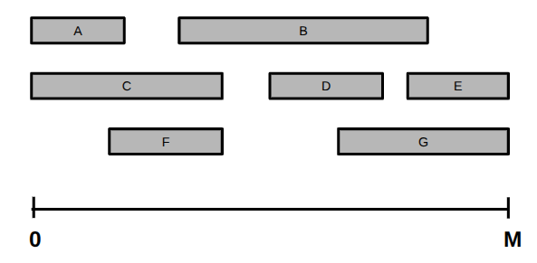
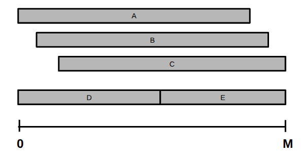
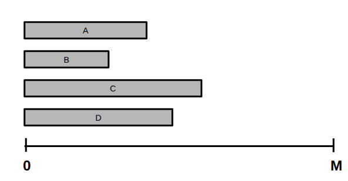
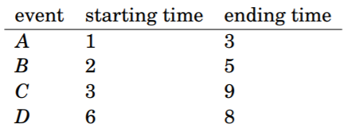
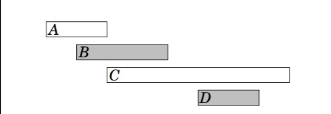

# Problemas clássicos com algoritmos gulosos

O estudo de algoritmos é muitas vezes estudar soluções que já existem. Muitos dos problemas clássicos são muito difíceis de se resolver quando vistos da primeira vez, o plano é tentar evoluir ao entender a ideia por trás da solução. 

Seu objetivo não é resolver todos os problemas, mas sim entender a ideia por trás da técnica gulosa e como aplicá-la em diferentes contextos.

# Cobertura de intervalos

Temos uma faixa linear de comprimento $M$ e um conjunto de $N$ intervalos, onde cada intervalo $i$ cobre a faixa no intervalo de $[L_i, R_i]$. O objetivo é escolher o menor número de intervalos que cubram toda a faixa de comprimento $M$, ou seja, cada ponto entre $[0, M]$ deve estar contido em pelo menos um dos intervalos escolhidos.

Restrições:
- $1 \leq N \leq 10^4$
- $1 \leq M \leq 10^9$
- $0 \leq L_i <= R_i \leq M$

Podemos desenhar os intervalos em uma linha do tempo, como na imagem abaixo:

Nesse exemplo, uma possível solução ótima é escolher os intervalos [C,B,G] selecionando 3 elementos. Também é possível escolher [C,B,E].

Pense em como resolver esse problema.

### Tentativa de solução

Podemos tentar escolher os maiores intervalos primeiro, até que a faixa esteja completamente coberta. Porém, não é garantido uma solução ótima, pois pode haver muita interseção entre eles. Nessa imagem, a escolha ótima é selecionar [D, E] ao invés de [A,B, C] que são maiores.

### Solução

A solução desse problema é construir a solução de forma incremental, da esquerda para direita. A cada passo, escolhemos o intervalo que cobre o ponto atual e termina o mais à direita possível.

No início, queremos começar cobrindo o ponto 0. Observe a seguinte imagem e veja qual o melhor intervalo para começar a cobrir?

Escolhemos o intervalo C como primeiro elemento da nossa solução. Suponha que esse intervalo termine no ponto $F_1$. Agora, queremos cobrir o ponto $F_1$, então escolhemos o intervalo qualquer que cobre $F_1$ e termina o mais à direita possível. Repita esse processo até que toda faixa esteja coberta ($F_i \geq M$). 

# Escalonamento de eventos

Imagine um local onde ocorrerão diversos eventos. Cada evento tem seu horário de início e horário de término e várias deles podem acontecer ao mesmo tempo em salas diferentes.

Você quer aproveitar o máximo e assistir ao maior número de eventos distintos. Você não pode assistir dois ao mesmo tempo. Se você entrar em um evento, não pode sair até que ele termine. Assim que terminar um evento, você pode entrar imediatamente em outro. 

Sua tarefa é determinar o maior número de apresentações que você pode assistir, respeitando as restrições.

Considere o seguinte evento:

Se desenharmos em uma linha do tempo, vemos que uma melhor solução é selecionar os eventos B e D:

Como resolver esse problema de forma geral? Pense um pouco antes de prosseguir.

## Tentativas de solução

Considere as seguintes soluções gulosas:

1. Escolher com prioridade os eventos com menor duração.
2. Escolher com prioridade os eventos que começam mais cedo.
3. Escolher com prioridade os eventos que terminam mais cedo.

Tente buscar e desenhar contra-exemplos para essas soluções gulosas.

## Solução

A solução para esse problema consiste em escolher com prioridade aqueles eventos que terminam mais cedo. A ideia é construir a solução de forma incremental.

Para começar considere como escolher o primeiro evento que você irá participar, ou seja, não haverá nenhum outro evento antes. Nesse caso qual o melhor primeiro evento a escolher?

Suponha que esse primeiro evento termine no tempo $F_1$. Agora, o segundo evento pode ser qualquer um que se inicie após $F_1$, logo minimizar $F_1$ permite termos mais opções para o segundo evento. Assim, a escolha do primeiro evento deve ser aquele que termina mais cedo.

Após determinar $F_1$, filtramos apenas os eventos que se iniciam após $F_1$ e repetimos o processo. O segundo evento escolhido será aquele que minimiza o seu tempo de término $F_2$, pois isso permitirá mais opções para o terceiro evento, e assim por diante.

