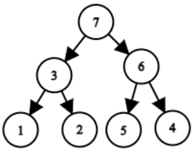
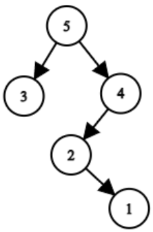

# Estagiário

Um CEO muito ocupado percebeu que sua empresa está crescendo rapidamente e precisa de ajuda para gerenciar sua equipe. Ele quer dividir os funcionários em grupos, onde cada grupo terá um líder, e quer também uma hierarquia de poder em vários níveis.

Para cada um de seus N funcionários, ele entregou um identificador único (entre 1 e N) indicando o poder que o funcionário possui. Ou seja, o funcionário 1 é o mais fraco, o funcionário 2 é mais forte que o funcionário 1, e assim por diante, até o funcionário N, que é o mais forte. Note que não há dois funcionários com o mesmo poder.


Agora, ele os organizou em uma fila e pretende formar grupos da seguinte forma:

1. O funcionário mais poderoso será o líder do grupo atual.
2. Dois novos grupos serão formados: um com os funcionários à esquerda do líder e outro com os funcionários à direita do líder.
3. O processo se repete para os novos grupos.
4. O líder do grupo atual é considerado líder imediato do líder de cada um dos dois novos grupos.
5. Se um grupo não tiver funcionários, ele não será formado.


Por exemplo, se a fila inicial é [1,3,2,7,5,6,4], teremos a seguinte hierarquia de líderes imediatos:



Outro exemplo, se a fila inicial é [3,5,2,1,4], teremos a seguinte hierarquia de líderes imediatos:



Sua tarefa é descobrir quais são os funcionários que não são líderes de ninguém, ou seja, os famosos estagiários da empresa.


---

## Entrada

A primeira linha da entrada contém um inteiro $N$ ($2 \leq N \leq 100$), indicando o número de funcionários.

A segunda linha contém $N$ inteiros $a_1, a_2, \dots, a_N$ ($1 \leq a_i \leq N$), representando a fila de funcionários e seus respectivos poderes.

---

## Saída

Imprima os identificadores em ordem crescente dos funcionários que são estagiários, em ordem crescente.

---

## Exemplos

### Exemplo 1

**Entrada:**
```text
4
1 2 3 4
```

**Saída:**
```text
1
```

---

### Exemplo 2

**Entrada:**
```text
7
1 3 2 7 5 6 4
```

**Saída:**
```text
1 2 4 5
```

---
