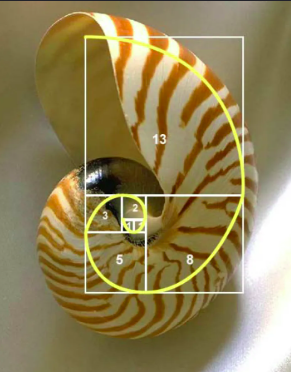

# Fibonacci

A sequência de Fibonacci é uma sequência curiosa que costuma aparecer nos mais diversos lugares na natureza.



O primeiro elemento da sequência é 0, o segundo é 1, e cada elemento subsequente é a soma dos dois termos da sequência de Fibonacci anteriores. Matematicamente, cada elemento $F_n$ é definido como:

$F_0 = 0$

$F_1 = 1$

$F_n = F_{n-1} + F_{n-2}, \quad \text{para } n \geq 2$


Por exemplo, os 10 primeiros termos são: 0, 1, 1, 2, 3, 5, 8, 13, 21, 34. 
Sua tarefa é implementar uma **função recursiva** que calcule o n-ésimo ($F_n$) número da sequência de Fibonacci.

---

## Entrada

A primeira linha da entrada contém um inteiro $N$ ($0 \leq N \leq 20$), indicando qual o termo da sequência deve ser calculado.

---

## Saída

Imprima um único inteiro, o n-ésimo número da sequência de Fibonacci.

---

## Exemplos

### Exemplo 1

**Entrada:**
```text
1
```

**Saída:**
```text
1
```

---

### Exemplo 2

**Entrada:**
```text
8
```

**Saída:**
```text
21
```

---
