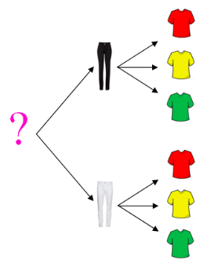
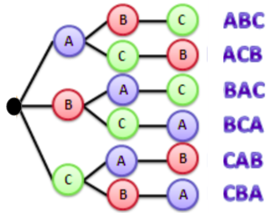
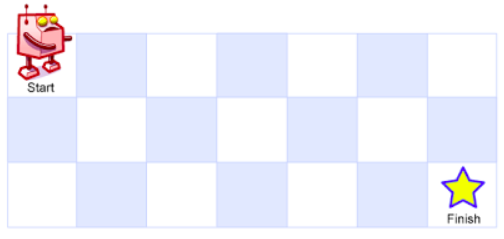

# Combinatória

Contagem é a prática de determinar o número de elementos de um conjunto. Por exemplo, contar a quantidade de palitos de fósforo dentro de uma caixa ou contar a quantidade de valores representáveis com 8 bits. A análise combinatória é a área que estuda técnicas de contagem como arranjos, permutações, combinações e anagramas.

Esse é um tópico bem comum, geralmente pedem que você conte quantas soluções distintas um determinado problema tem. Muitas vezes não adianta apenas saber os princípios de contagem, mas também precisamos unir esse conhecimento com outras técnicas de programação como busca completa, programação dinâmica e grafos.

## Regra da multiplicação

O princípio multiplicativo diz que se uma coisa tem $n$ jeitos de acontecer e outra coisa tem $m$ jeitos de acontecer, o total de formas para as duas coisas acontecerem juntas é a conta de vezes: $n \times m$.

Por exemplo, se você quer escolher seu traje e 2 calças e 3 camisas, você pode escolher um total de 6 formas de se vestir. Para cada uma das duas calças, você tem três opções de camisa, totalizando 6 opções distintas. Esse exemplo pode ser visualizado em formato de diagrama de árvore:

A regra da multiplicação também pode ser expandida para mais de duas opções. Por exemplo, se você tem 2 calças, 3 camisas e 4 pares de sapatos, o total de formas de se vestir é $2 \times 3 \times 4 = 24$.

Através desse simples princípio, podemos chegar a fórmulas mais complexas da combinatória:

- Permutações: $P(N) = N!$
- Arranjos: $A(N, K) = \frac{N!}{(N-K)!}$
- Combinações: $C(N, K) = \frac{N!}{K!(N-K)!}$
- Anagramas: $\frac{N!}{f_a!f_b!...f_z!}$

Seguem abaixo as definições de cada um desses conceitos.

## Permutações

Uma permutação de tamanho N é uma sequência de N elementos distintos onde a ordem importa. Por exemplo, se você tem 3 elementos distintos A, B e C, as permutações possíveis são:

- ABC
- ACB
- BAC
- BCA
- CAB
- CBA

Podemos usar a regra da multiplicação para calcular o total de permutações possíveis. No caso da permutação de tamanho 3, temos 3 opções para o primeiro elemento. Depois de usar um elemento, temos 2 opções para o segundo elemento e 1 opção para o terceiro elemento. Portanto, o total de permutações é $3 \times 2 \times 1 = 6$.

Para ser mais genérico, podemos contar o total de permutações de N elementos distintos como $N!$, que é multiplicação de todos os números inteiros positivos de N até 1. Por exemplo, $5! = 5 \times 4 \times 3 \times 2 \times 1 = 120$.

Cuidado! Como o fatorial é um número que cresce muito rápido, é comum que problemas peçam para aplicar a operação de resto sobre a respota. Veremos mais nas próximas seções.

## Arranjo

Um arranjo de tamanho K de N elementos distintos é uma sequência de K elementos distintos escolhidos entre os N elementos, onde a ordem importa. Por exemplo, se você tem uma competição com 4 participantes distintos A, B, C e D e quer saber quantas formas os participantes podem ocupar o primeiro e segundo lugar, temos:

- AB, AC, AD
- BA, BC, BD  
- CA, CB, CD
- DA, DB, DC

Temos um total de 12 formas distintas de ocupar o primeiro e segundo lugar. Usando a regra da multiplicação, temos 4 opções para o primeiro lugar e 3 opções para o segundo lugar, totalizando $4 \times 3 = 12$ formas distintas.

A fórmula geral para o total de arranjos de tamanho K de N elementos distintos é:
$$A(N, K) = \frac{N!}{(N-K)!}$$

## Combinação

No caso anterior, a ordem dos elementos importam, contando alguns casos como (A,B) e (B,A) como distintos. Se a ordem não importa podemos pegar esse resultado e descontar todas as permutações possíveis do arranjo (dividindo por K!).

Por exemplo, se você tem uma competição com 4 participantes distintos A, B, C e D e quer saber quantas formas podemos escolher dois participantes para próxima etapa, temos:

- AB, AC, AD
- BC, BD
- CD

Que é exatamente $\frac{4!}{2!2!} = 6$ formas distintas de escolher dois participantes.

Combinação é uma seleção de K elementos distintos escolhidos entre N elementos, onde a ordem não importa. Sua fórmula geral é:
$$C(N, K) = \frac{N!}{K!(N-K)!}$$

## Anagrama

Um anagrama de uma palavra consiste em mudar a ordem de suas letras, gerando uma nova palavra distinta. Por exemplo, a palavra "abc" tem os seguintes anagramas:

- abc
- acb
- bac
- bca
- cab
- cba

A dificuldade surge quando temos letras repetidas. Por exemplo, a palavra "aba" tem os seguintes anagramas:

- aba
- aab
- baa

A ideia para calcular o total de anagramas de uma palavra é semelhante a contar a quantidade de permutações de N elementos. No entanto, precisamos descontar todas as permutações de cada grupo de letras repetidas. Por exemplo, a palavra "batata" tem 6 letras, mas 3 delas são iguais (as letras "a") e 2 delas são iguais (as letras "t"). Portanto, o total de anagramas de "batata" é:

$$\frac{6!}{3!2!} = 60$$

Considere $f_i$ como a quantidade de vezes que a letra $i$ se repete. A fórmula geral para o total de anagramas de uma palavra com N letras, onde cada letra $i$ se repete $f_i$ vezes é:
$$\frac{N!}{f_a!f_b!...f_z!}$$

## Exemplo

Dado uma matriz de tamanho N x M, um robô está localizado na célula (1, 1) e deseja chegar na célula (N, M). O robô só pode se mover para a direita ou para baixo. Quantos caminhos distintos o robô pode percorrer para chegar na célula (N, M)?

No exemplo acima, temos uma matriz de tamanho 3 x 7. Note que se o robô se move 6 vezes para a direita e 2 vezes para baixo ele chega ao destino. Então precisamos contar as formas diferentes de fazer isso.

Podemos representar um caminho como uma string "RRRRRRDD", onde "R" é um movimento para direita e "D" é um movimento para baixo. Dessa forma, o problema se resume a contar quantos anagramas essa string tem. Resposta: $\frac{8!}{6!2!} = 28$. 

Resposta geral para uma matriz de tamanho N x M é:
$$\frac{(N-1+M-1)!}{(N-1)!(M-1)!}$$

## Material complementar

- Combinatorics Study Notes - [https://codeforces.com/blog/entry/110376](https://codeforces.com/blog/entry/110376)