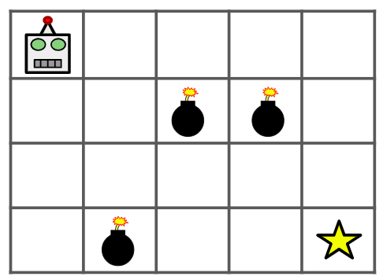

# Robô V1

## Descrição do Problema




Há um robô num tabuleiro de dimensões n x m. O robô encontra-se inicialmente no canto superior esquerdo, isto é, na posição (0,0). O robô pretende mover-se para o canto inferior direito, isto é, para posição (n-1, m-1).

O robô só pode se mover para baixo ou para a direita. Algumas células estão vazias, representadas por `0`, e outras estão bloqueadas por minas, representadas por `1`.

Dada a matriz composta de `0` e `1`, determine quantos caminhos distintos existem para o robô chegar até a célula final, sem passar por nenhuma mina. Como a resposta pode ser muito grande, imprima módulo $10^9+7$.

## Entrada

A primeira linha contém dois inteiros `n` e `m` (`1 <= n, m <= 100`).

As próximas `n` linhas contêm `m` inteiros cada, representando o tabuleiro:

- `0` = célula vazia
- `1` = célula bloqueada por mina

---

## Saída

Imprima um único inteiro: o número de caminhos únicos que o robô pode tomar para chegar até a célula final módulo $10^9+7$.

---

## Exemplos

### Exemplo 1

**Entrada:**
```text
3 3
0 0 0
0 1 0
0 0 0
```

**Saída:**
```text
2
```

**Explicação:**
Há exatamente dois caminhos possíveis:

- RRDD
- DDRR
