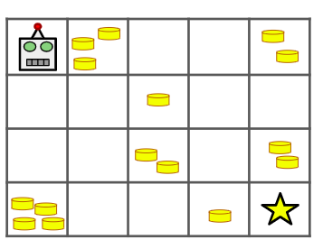

# Robô V2

## Descrição do Problema



Há um robô num tabuleiro de dimensões n x m. O robô encontra-se inicialmente no canto superior esquerdo, isto é, na posição (0,0). O robô pretende mover-se para o canto inferior direito, isto é, para posição (n-1, m-1).

O robô só pode se mover para baixo ou para a direita. Algumas células possuem moedas nelas. O objetivo do robô é coletar o máximo de moedas possível enquanto se move para a célula final. Mostre a quantidade de moedas que o robô consegue coletar se escolher o melhor caminho possível.

## Entrada

A primeira linha contém dois inteiros `n` e `m` .

As próximas `n` linhas contêm `m` inteiros cada. Cada inteiro T[i][j] representa o número de moedas na célula daquela posição.


## Saída

Imprima um único inteiro: o maior número de moedas que o robô pode coletar no caminho para a célula final.

## Restrições

* $1 \leq n, m \leq 100$
* $0 \leq T[i][j] \leq 10^9$

## Exemplos

### Exemplo 1

**Entrada:**
```text
4 5
0 3 0 0 2
0 0 1 0 0
0 0 2 0 2
4 0 0 1 0
```

**Saída:**
```text
8
```

