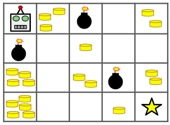

# Robô V3

## Descrição do Problema



Há um robô num tabuleiro de dimensões n x m. O robô encontra-se inicialmente no canto superior esquerdo, isto é, na posição (0,0). O robô pretende mover-se para o canto inferior direito, isto é, para posição (n-1, m-1). O robô só pode se mover para baixo ou para a direita.

Algumas células possuem moedas nelas, enquanto outras possuem bombas. O objetivo do robô é coletar o máximo de moedas possível enquanto se move para a célula final, sem passar por nenhuma célula com bomba. Mostre a quantidade de moedas que o robô consegue coletar se escolher o melhor caminho possível, ou indique se é impossível evitar as bombas.

## Entrada

A primeira linha contém dois inteiros `n` e `m`.

As próximas `n` linhas contêm `m` inteiros cada. Cada inteiro T[i][j] representa o número de moedas na célula daquela posição ou -1 se a célula contiver uma bomba.

## Restrições

* $1 \leq n, m \leq 100$
* $-1 \leq T[i][j] \leq 10^9$

## Saída

Imprima um único inteiro: o maior número de moedas que o robô pode coletar no caminho para a célula final. Caso não seja possível evitar as bombas para chegar no fim, imprima -1.

---

## Exemplos

### Exemplo 1

**Entrada:**
```text
4 5
0 3 -1 0 2
-1 0 1 0 0
4 0 2 -1 2
5 0 0 1 0
```

**Saída:**
```text
7
```

Esse é o caso ilustrado na imagem no enunciado.

### Exemplo 2

**Entrada:**
```text
5 2
0 3
-1 0
0 0
0 -1
4 0
```

**Saída:**
```text
-1
```

