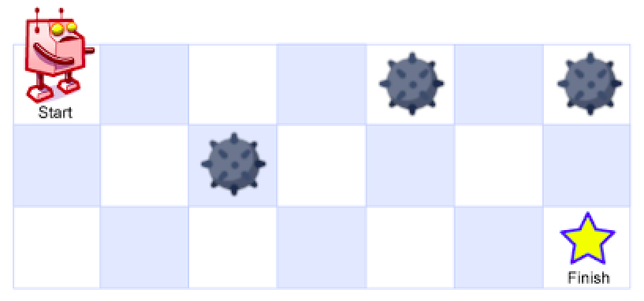
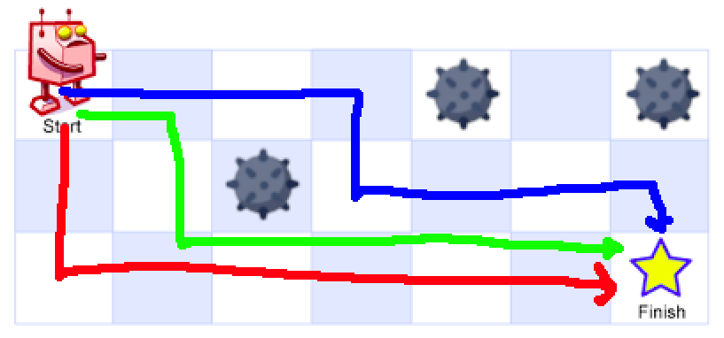

# Introdução a programação dinâmica

Quando se fala em programação dinâmica, geralmente o objetivo é aplicar técnicas para otimizar um algoritmo que realiza muitos cálculos repetidos. A principal ideia é armazenar um resultado de um subproblema para que ele não precise ser recalculado várias vezes.

Por exemplo, considere a função que calcula o fatorial de N:

```cpp
int fatorial(int n) {
    if (n == 0) return 1;
    return (n * fatorial(n - 1)) % MOD;
}
```

Essa função realiza o cálculo em O(N), ela irá calcular o mesmo fatorial do zero várias vezes. Para otimizar isso, podemos precalcular todos os valores possíveis e armazenar num vetor:

```cpp
const int MAXF = 1000010;
int fatorial[MAXF];

int precalc(){
    fatorial[0] = 1;
    for (int i = 1; i < MAXF; i++) {
        fatorial[i] = (i * fatorial[i - 1]) % MOD;
    }
    return 0;
}
```

O código acima também é O(N), mas depois de executar a função `precalc()` uma vez, podemos calcular o fatorial de qualquer número em O(1). Também veremos exemplos mais agressivos, onde a programação dinâmica pode reduzir o tempo de execução de $O(2^N)$ para O(N).

## Tabulação

A primeira técnica que veremos é a **tabução**. A ideia é usar uma tabela (vetor, matriz, mapa, etc) para armazenar os resultados do problema.

Iremos preencher essa tabela de forma iterativa e, a cada passo, usaremos os resultados já salvos para calcular o próximo resultado. Por exemplo, no exemplo acima usamos o fatorial[i-1] para calcular fatorial[i].


## Exemplo: Fibonacci

Considere a seguinte função recursiva que calcula o N-ésimo número de Fibonacci:

```cpp
int fib(int n) {
    if (n == 0) return 0;
    if (n == 1) return 1;
    return fib(n - 1) + fib(n - 2);
}
```

Esse código tem complexidade O(2^N), pois a cada chamada da função, duas novas chamadas são feitas. Usando programação dinâmica, podemos usar os valores já calculados para otimizar para O(N):

```cpp
int fib[MAXN];

int precalc() {
    fib[0] = 0;
    fib[1] = 1;
    for (int i = 2; i < MAXN; i++) {
        fib[i] = fib[i - 1] + fib[i - 2];
    }
    return 0;
}
```

## Tabela

A partir de agora, iremos chamar essa tabela de **DP**. Para preencher a tabela, começamos com os casos base, que são os mais simples, e depois vamos preenchendo a tabela até chegar no resultado final.

Percorremos a DP utilizando laços. Cuidado com a ordem do preenchimento: é necessário que as posições anteriores já estejam preenchidas antes de calcular a posição atual.

Não há limites para o que pode ser calculado na DP, podemos calcular somas, produtos, máximos, mínimos, contagens etc. 

## Exemplo: Ladrão

Um ladrão está planejando roubar casas em uma rua. Cada casa tem uma certa quantidade de dinheiro guardada, mas o ladrão não pode roubar duas casas adjacentes, pois isso chamará muita atenção.

O objetivo é determinar a quantidade máxima de dinheiro que o ladrão pode roubar.

Solução:

```cpp
#include <bits/stdc++.h>
using namespace std;

const int MAXN = 100010;
int valor[MAXN], n;
int dp[MAXN];

void solve(){
    dp[0] = valor[0];
    dp[1] = max(valor[0], valor[1]);

    for(int i = 2; i < n; i++){
        // caso roube a casa i
        int rouba = valor[i] + dp[i-2];
        // caso não roube a casa i
        int nrouba = dp[i-1];

        dp[i] = max(rouba, nrouba);
    }
}

int main(){
    cin >> n;
    for(int i = 0; i < n; i++){
        cin >> valor[i];
    }
    solve();
    
    // Mostra a resposta final
    cout << dp[n-1] << endl;
}
```

## Exemplo: Robô

Você recebe uma matriz com N linhas e M colunas. No canto esquerdo superior, se encontra um robô que pode fazer dois tipos de movimentos: se mover para baixo ou se mover para direita. O objetivo do robô é alcançar o final da matriz, no canto inferior direito.

Além disso, existem células da matriz que estão bloqueadas com minas, ou seja, não é permitido que o robô passe por elas.




Perceba que um caminho como "RRRDRRRD" é válido, mas "DRRRRRRD" não é pois passa por cima de uma mina. Veja alguns exemplos de caminhos válidos:



Para esse problema, queremos contar de quantas formas é possível o robô alcançar seu objetivo. Em outras palavras, contar quantos caminhos sã válidos.


### Solução

Esse problema envolve um cenário 2D. Normalmente, usamos uma matriz com duas dimensões `dp[i][j]` para salvar a resposta do subproblema que termina na posição `i` e `j`.

Para o problema do robô, `dp[i][j]` guarda a quantidade de caminhos diferentes que o robô consegue chegar na posição (i,j).

Note que `dp[0][0]` é igual a 1, pois só existe uma forma de chegar na posição inicial (nenhum movimento). Além disso, se existe uma bomba na posição (i,j), então `dp[i][j]` é igual a 0, pois não queremos que seja possível passar pela bomba.

Para qualquer outro caso, a quantidade de formas de chegar na posição (i,j) pode ser calculada da seguinte forma: `dp[i][j] = dp[i-1][j] + dp[i][j-1]`. 

Isso acontece por que para cada célula vazia temos duas possibilidades: OU o robô chegará pelos caminhos de cima OU chegará pelos caminhos da esquerda. Veja o seguinte exemplo:

![Exemplo de como calcular dp[i][j]](midia/robo_minas_soma_caminho.png)

Nesse exemplo, há 3 caminhos para a célula esquerda do objetivo e 1 forma de alcançar a célula de cima. Logo há 4 caminhos que alcançam o objetivo.

Temos enfim, a seguinte implementação:

```cpp
#include <bits/stdc++.h>
using namespace std;

const int MAXN = 101;

int dp[MAXN][MAXN];
int mat[MAXN][MAXN];
int n, m;


int main(){
    cin >> n >> m;
    for(int i = 0; i < n; i++){
        cin >> mat[i][j];
        // 1 se tem bomba
        // 0 caso contrario
    }

    for(int i = 0; i < n; i++){
        for(int j = 0; j < m; j++){
            if(i == 0 && j == 0){ 
                dp[i][j] = 1;
            } else if(mat[i][j] == 1){
                dp[i][j] = 0;
            } else {
                dp[i][j] = 0;
                if(i > 0) dp[i][j] += dp[i-1][j];
                if(j > 0) dp[i][j] += dp[i][j-1];
            }
        }
    }
    
    cout << dp[n-1][m-1] << endl;
}
```


## Tipos de problemas resolvidos com DP

Resolver problemas de contagem não é a única aplicação de DP. Na verdade, podemos resolver dos mais diversos problemas. No exemplo do robô, temos esses exemplos de variedade:

| Tipo de Problema | O que `dp[i][j]` representa | Cálculo
| :--- | :--- | :--- |
| Contagem de caminhos (*Path counting*) | Número de caminhos únicos até $(i, j)$ | dp[i][j] = dp[i-1][j] + dp[i][j-1] |
| Caminho de custo mínimo | Custo mínimo para alcançar $(i, j)$ | dp[i][j] = val[i][j] + min(dp[i-1][j], dp[i][j-1])|
| Caminho de valor máximo | Valor máximo acumulável ao alcançar $(i, j)$ |  dp[i][j] = val[i][j] + max(dp[i-1][j], dp[i][j-1])|
| Acessibilidade booleana (*Boolean reachability*) | Se $(i, j)$ é alcançável sob restrições | dp[i][j] = dp[i-1][j] \|\| dp[i][j-1] |
| DP em direção reversa (*Reverse-direction DP*) | Valor mínimo necessário em $(i, j)$ para alcançar o objetivo | dp[i][j] = val[i][j] + min(dp[i-1][j], dp[i][j-1]) |