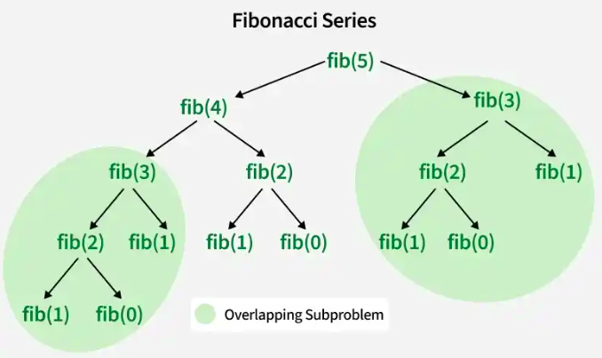

# Programação dinâmica com memoização

Muitos problemas são mais fáceis de se pensar e resolver de forma recursiva. Em casos onde a recursão gera muitas chamadas recursivas repetidas, podemos usar a técnica de **memoização**.

A ideia é parecida com a tabulação que vimos antes na tabulação, usaremos uma tabela para armazenar o que foi calculado. Quando uma chamada recursiva é feita, primeiro verificamos se a tabela já foi preenchida naquela posição, caso sim, simplesmente retornamos o valor da tabela em O(1). Caso contrário, calculamos o valor e armazenamos na tabela.


## Exemplo: Fibonacci

Essa é a função do Fibonacci sem otimização em $O(2^N)$:

```cpp
int fib(int n) {
    if (n == 0) return 0;
    if (n == 1) return 1;
    return fib(n - 1) + fib(n - 2);
}
```

A complexidade é alta devido a grande quantidade de chamadas recursivas repetidas. Veja a árvore de chamadas recursivas para calcular `fib(5)`:



Observe como o fib(3) é chamado duas vezes, realizando o mesmo calculo novamente.

Faremos os seguintes passos para aplicar a memoização:
1. Criamos um vetor chamado `dp` para armazenar o que é calculado.
2. Iniciaremos todo o vetor com -1, então sabemos `dp[i] == -1` indica que aquela posição não foi calculada ainda.
3. Na chamada recursiva, verificamos se `dp[i] != -1`. Se sim, retornamos o `dp[i]`.
4. Caso contrário, calculamos o valor e armazenamos em `dp[i]` antes de retornar.

Temos o seguinte código:


```cpp
#include <bits/stdc++.h>
using namespace std;
const int MAXN = 100010;

int dp[MAXN];

int fib(int i){
    // casos bases
    if(i == 0) return 0;
    if(i == 1) return 1;

    // verifica se já foi calculado
    if(dp[i] != -1) return dp[i];

    // armazena o valor calculado 
    dp[i] = fib(i - 1) + fib(i - 2);
    return dp[i];
}

int main(){
    for(int i = 0; i < MAXN; i++) dp[i] = -1;
    int n;
    cin >> n;
    cout << fib(n) << endl;
}
```

A complexidade do código otimizado é O(N), pois cada posição do vetor `dp` é calculada apenas uma vez em O(1). Note também que alteramos apenas duas linhas de código dentro da recursão. Ou seja, depois de resolver o problema de forma recursiva, a memoização é geralmente simples de se aplicar.

## Complexidade

A complexidade da programação dinâmica com memoização pode ser calculada multiplicando o número de estados possíveis (tamanho da tabela) e o tempo gasto para calcular cada posição da tabela.


## Tabulação vs Memoização

Na maioria dos casos, a tabulação é mais eficiente que a memoização, pois chamadas recursivas tendem a ser mais lentas e gastar mais memória que a solução iterativa. Além disso, dependendo do problema, a tabução permite algumas otimizações mais avançadas.

Por outro lado a memoização é mais fácil de se implementar, pois podemos começar com uma solução recursiva e adicionar a memoização com algumas poucas modificações.

Minha recomendação é começar com a memoização, e depois, se necessário, passar para a tabulação.


 

