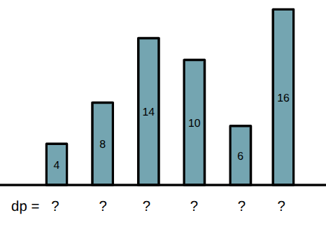
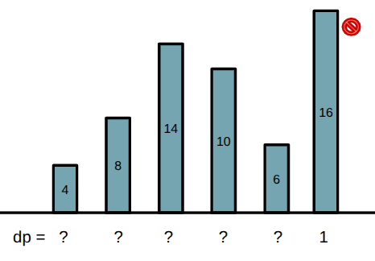
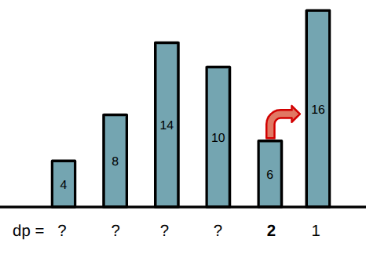
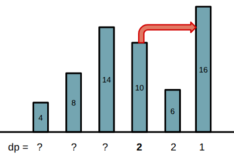
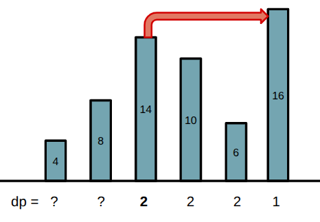
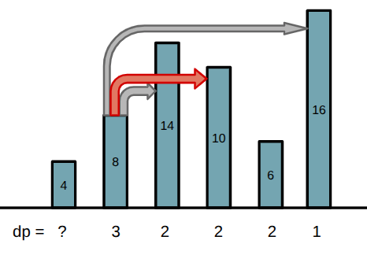
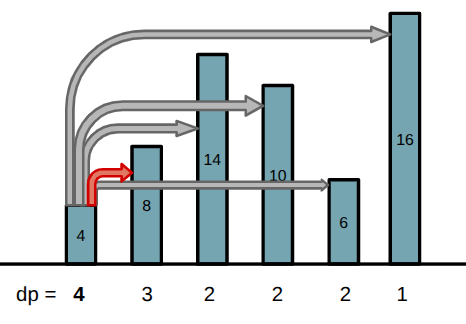
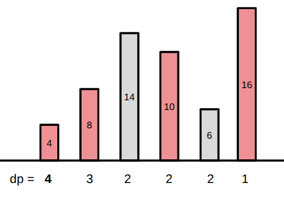

## Subsequência 

Uma sequência é uma coleção de elementos onde a ordem importa (ex: array e string).

Uma subsequência é uma sequência que pode ser obtida ao escolher alguns elementos de uma sequência original e manter a ordem relativa original desses elementos escolhidos.

Por exemplo, a sequência [4, 10, 20, 34, 5, 10] possui as seguintes subsequências:
* [4, 10, 20]
* [10]
* [10, 5, 10]
* [4, 10, 20, 34, 10]
* []

Note que uma subsequência não precisa ser formada por elementos consecutivos e que podemos formar um total de $2^n$ subsequências através de uma sequência de tamanho $n$.


## Maior subsequência crescente (LIS)

O problema da Maior Subsequência Crescente (Longest Increasing Subsequence - LIS) consiste em encontrar a subsequência **crescente** mais longa dentro de uma sequência.

Por exemplo, a sequência [4, 10, 30, 26, 5, 60] possui as seguintes subsequências crescentes:

* [5, 60]
* [4, 10, 30]
* [4, 10, 30, 60]
* [5, 10, 26, 60]

Para esse problema o tamanho da LIS é 4.

## Solução

Primeiro, resolveremos esse problema em $O(n^2)$ com programação dinâmica. A ideia é guardar em dp[i] o valor da maior subsequência crescente que é possível formar utilizando o elemento na posição i e os demais a frente. Iremos resolver a dp do final do vetor para o começo.

Para calcular $dp[i]$, verificamos todos os índices $j$ a frente ($j > i$) e, se aquele elemento $j$ for maior ($A[j] > A[i]$), então podemos formar uma subsequência crescente incluindo $A[i]$ e a subsequência começando em $A[j]$.

Basta escolher o $j$ maior com maior valor $dp[j]$ que respeite a respeite a condição $A[j] > A[i]$. Após encontrar o $j$, calculamos $dp[i] = 1 + dp[j]$.

Caso nenhum elemento a frente seja maior que $A[i]$, então $dp[i] = 1$.


Por exemplo, Considere a sequencia A = [4, 8, 14, 10, 6, 16]:



Para cada posição, indo da direita para esquerda, calculamos o valor de dp[i] de acordo com os elementos na frente. Como o último elemento 16 não tem nada a frente, então dp[5] = 1 (sua maior subsequência possui apenas o elemento 16).



Já o penúltimo elemento 6 pode formar uma subsequência crescente junto com o 16, então dp[4] = 2 ([6, 16]).



O elemento 10 não pode formar uma subsequência crescente com o 6 (menor que 10), mas pode formar com o 16, então dp[3] = 2 ([10, 16]).



O elemento 14 pode combinar apenas com o 16, então dp[2] = 2 ([14, 16]).



Agora ocorre algo interessante no elemento 8, ele pode escolher formar uma subsequência com 14, 10 ou 16. Qual desses escolher?

A melhor escolha é o 14 ou 10, pois esses formam as maiores subsequências a partir deles (tem valor dp = 2). Dessa forma, dp[1] = 3 ([8, 14, 16] ou [8, 10, 16]).



Finalmente, o primeiro elemento 4 pode formar subsequências crescentes com 8, 14, 10 ou 16. A melhor escolha é o 8, que leva à maior subsequência crescente a partir dele. Temos então dp[0] = 4 ([4, 8, 14, 16]).



Por fim, de todos os valores de dp[i], escolhemos o maior (dp[0] = 4). Sabemos que o tamanho da maior subsequência crescente é 4.



## Implementação

Essa ideia pode ser implementada em $O(n^2)$ com tabulação:

```cpp
#include <bits/stdc++.h>
using namespace std;
const int MAXN = 2000;

int A[MAXN], n;
int dp[MAXN];

int main(){
    cin >> n;
    for(int i = 0; i < n; i++){
        cin >> A[i];
    }

    for(int i = n-1; i >= 0; i--){
        dp[i] = 1;
        for(int j = i+1; j < n; j++){
            if(A[j] > A[i]){
                dp[i] = max(dp[i], 1 + dp[j]);
            }
        }
    }

    int ans = 0;
    for(int i = 0; i < n; i++){
        ans = max(ans, dp[i]);
    }
    cout << ans << endl;
}
```

## Otimização

Isso não será cobrado na disciplina, mas o LIS pode ser otimizado para $O(n \log n)$ utilizando a técnica uma memorização diferente com busca binária ou se utilizando de estruturas de dados para encontrar o valor máximo de forma mais eficiente sem o for interno. Você pode consultar uma explicação mais detalhada aqui: [Usaco Guide - Longest Increasing Subsequence
](https://usaco.guide/gold/lis).

