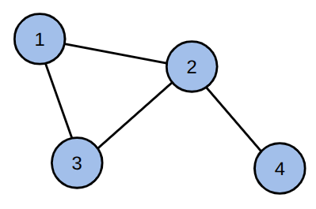
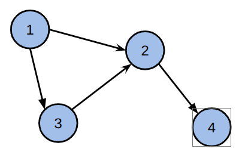
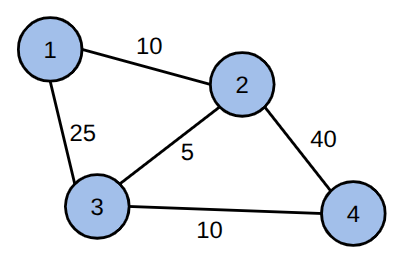

## O que são grafos?

Grafos não são nada mais e nada menos que uma forma de representar **relações** entre **objetos**. Esses objetos podem ser qualquer coisa e a relação pode ser de qualquer tipo.

Seguem alguns exemplos de coisas que podem ser representadas como grafos:

* **Redes sociais**: os objetos são os usuários das redes sociais e as relações são amizades entre dois usuários.
* **Mapas de cidades**: os objetos são as cidades e as relações são os voos que conectam duas cidades.
* **Hierarquia de uma empresa**: os objetos são os funcionários e a relação pode ser de superior para subordinado.
* **Mapa de propagação de doenças**: os objetos são as pessoas e a relação é a proximidade que pode transmitir uma doença de uma pessoa para outra.

Muitos problemas importantes do mundo real podem ser modelados e resolvidos utilizando grafos. Por esse motivo o conhecimento em grafos é bastante requisitado em mestrados na área de algoritmos e empregos em empresas de grande porte.

## Definição

Formalmente, chamamos os objetos de **vértices** (ou nós) e as relações de **arestas**. Um grafo é descrito por dois conjuntos: o conjunto de vértices $V$ e o conjunto de arestas $E$, ou seja, um grafo $G$ é definido como $G = (V, E)$.

Por exemplo, considere um grafo com os vértices $V = \{1, 2, 3, 4\}$ e as arestas $E = \{\{1, 2\}, \{1, 3\}, \{2, 3\}, \{2, 4\}\}$. Podemos representar visualmente os vértives como circulos e arestas como linhas conectando os vértices:

## Tipos de grafos

Temos vários tipos de grafo dependendo do problema que vamos resolver. Alguns comuns são:

### Grafo direcionado e não direcionado

Em um grafo direcionado, as arestas possuem uma direção, ou seja, uma aresta u → v é diferente de uma aresta v → u.

Grafos direcionados podem ser úteis para modelar relações como a de seguir uma pessoa em redes sociais (nem sempre é seguida de volta) ou representar ruas e estradas de mão única.

Por exemplo, considere um grafo direcionado com os vértices $V = \{1, 2, 3, 4\}$ e as arestas $E = \{(1, 2), (3, 2), (1, 3), (2, 4)\}$:

Quando o grafo é direcionado, não há diferença entre a aresta u → v e a aresta v → u. Podemos modelar relações como amizades em redes sociais, onde a amizade é mútua, ou ruas onde há sempre mão dupla.

### Grafos ponderados

Em um grafo ponderado, cada aresta possui um **peso** associado, que pode representar, por exemplo, a distância entre duas cidades ou quantidade de mensagens trocadas entre dois usuários numa rede social.

Note que um grafo pode ser ponderado e direcionado ao mesmo tempo.

### Grafos simples

Um grafo simples é um grafo que não possui arestas que conectam um vértice a ele mesmo (u → u) e não possui múltiplas arestas entre os mesmos vértices (duas ocorrências de u → v).

## Representação de gráficos em código

Há três estruturas de dados principais de representar os grafos:

* **Matriz de adjacência**: uma matriz $n \times n$ onde $n$ é o número de vértices. A célula $M[i][j]$ indica se há uma aresta entre os vértices $i$ e $j$ (pode ser 0 ou 1, ou o peso da aresta).

* **Lista de arestas**: é uma lista de todas as arestas do grafo (pode ser vector<pair<int, int>>), onde cada aresta é um par de vértices $(u, v)$.

* **Lista de adjacência**: um array de listas, onde cada posição $i$ contém uma lista dos vértices adjacentes ao vértice $i$.

Veremos com mais detalhes nas próximas aulas.