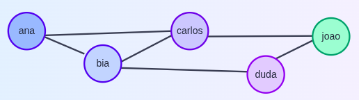

# Rede social



Na rede social "Iorgut" foi criada com o objetivo de conectar todas as pessoas fãs de iogurte e seus derivados. Nessa rede, cada usuário possui por um nick único (apelido). Ao adicionar um amigo, é possível compartilhar receitas, fotos e mensagens relacionadas a iogurte com essa pessoa.

Seu trabalho é analisar as relações de amizade e descobrir qual é o usuário mais popular, ou seja, possui o maior número de amigos.

O problema é que a coleta dos dados nem sempre é perfeita, e pode haver inconsistências ou duplicidades nas informações sobre amizades. Se uma amizade for registrada mais de uma vez, não se deve contar duas vezes.


---

## Entrada

A primeira linha contém dois inteiros N e M, indicando o número de usuários da rede e o número de amizades, respectivamente.

Depois, há M linhas, cada uma contendo dois nicks U e V, indicando que U e V são amigos. Note que uma amizade pode ser registrada mais de uma vez, mas deve ser contada apenas uma vez.


## Saída

Imprima o nick do usuário que possui o maior número de amigos.

Se houver empate, imprima o nick que vier primeiro em ordem alfabética.

## Restrições

- $1 \le N \le 10^5$
- $0 \le M \le 10^5$
- O comprimento de cada nick é no máximo 20 caracteres.
- Os nicks são distintos.

## Exemplo

### Entrada:
```text
5 6
ana bia
ana carlos
bia carlos
bia duda
carlos joao
carlos joao
```

### Saída:
```text
bia
```
