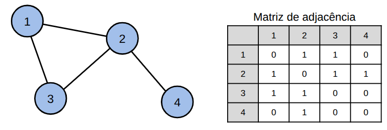
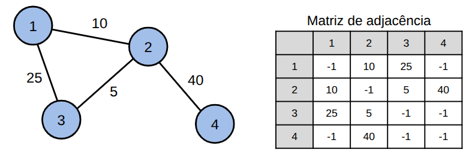

## Representação de Grafos: Matriz de Adjacência

A matriz de adjacência é uma forma de representar um grafo utilizando uma matriz $n \times n$, onde $n$ é o número de vértices do grafo. Cada célula $M[i][j]$ indica se há uma aresta entre os vértices $i$ e $j$. Em grafos não ponderados, pode armazenar 0 (não existe aresta entre $i$ e $j$) ou 1 (existe aresta entre $i$ e $j$).

Por exemplo, o seguinte grafo pode ser representado por uma matriz de adjacência:




## Grafo ponderado

Quando o grafo é ponderado, podemos guardar os pesos diretamente na matriz de adjacência ao invés de armazenar apenas 0 ou 1. Quando não existe uma aresta entre os vértices $i$ e $j$, podemos armazenar um valor especial, como -1 ou infinito (valor bem alto), dependendo da aplicação.




## Implementação

A seguir, um exemplo de implementação em C++ de um grafo utilizando matriz de adjacência:

```cpp
#include <bits/stdc++.h>
using namespace std;

const int MAXN = 100;
int mat[MAXN][MAXN];

int main() {
    int n = 4;
    // indexidando a partir de 0
    mat[0][1] = 1;
    mat[2][1] = 1;
    mat[0][2] = 1;
    mat[1][3] = 1;

    // imprimindo
    for (int i = 0; i < n; i++) {
        for (int j = 0; j < n; j++) {
            if(mat[i][j] == 1){
                cout << "Aresta " << i << " -> " << j << endl;
            }
        }
        cout << endl;
    }

    return 0;
}
```

## Complexidade

A principal limitação da matriz de adjacência é o consumo de memória, que é $O(n^2)$, mesmo que o grafo tenha poucas arestas.

Além disso, temos as seguintes complexidades:

* Verificar se existe aresta entre vértices u e v: $O(1)$.
* Inserir ou remover uma aresta entre vértices u e v: $O(1)$.
* Percorrer todos os vizinhos de um vértice u: $O(n)$.
* Listar todas as arestas do grafo: $O(n^2)$.

Quando o grafo é muito denso (possui muitas arestas), a matriz de adjacência é uma representação boa. No entanto, em grafos esparsos (com poucas arestas), há um desperdício grande de tempo e espaço para armazenar os valores 0. Nesses casos, lista de arestas ou lista de adjacência são mais apropriados.